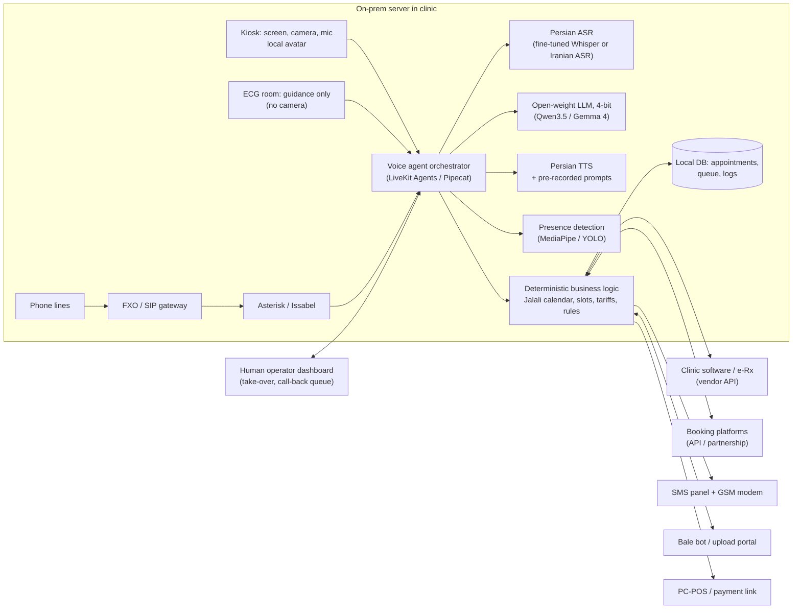

# امکان‌سنجی منشی مجازی هوشمند برای مطب متخصص قلب

| | |
|---|---|
| تاریخ | 26 مهر 1405 (18 October 2026) |
| نسخه | 1.0 (پیش از تصمیم‌گیری) |
| دامنه | جایگزینی کامل یا جزئی منشی مطب قلب با یک دستیار هوشمند فارسی‌زبان (آواتار، دوربین، تلفن، کانال‌های آنلاین) |
| واحد پول | تومان. نرخ پایه: هر دلار حدود 260,000 تومان (بازار آزاد مهر 1405 بین حدود 255 تا 270 هزار) |

> **دربارهٔ اعداد:** قیمت سرویس‌های خارجی از صفحات رسمی یا ردیاب‌های قیمت (تا مهر 1405) گرفته شده است. قیمت سخت‌افزار در ایران و هزینهٔ برنامه‌نویس **برآورد** هستند و پیش از تصمیم باید استعلام شوند. حجم کار مطب «فرض» است و در فاز صفر باید اندازه‌گیری شود. همهٔ محاسبه‌ها با فرض‌های بخش 2 قابل تکرارند.

> **ادامه:** [آستانه‌های عملی شدن طرح](viability-thresholds.md): از چه نقطه‌ای به بعد (دقت، CPU، نوع مطب، نرخ دلار، مقیاس) طرح در ایران عملی می‌شود.

---

## 0. خلاصهٔ مدیریتی

**جواب کوتاه:** «منشی صددرصد مجازی» برای مطب قلب در ایرانِ 1405 **نه از نظر فنی کامل شدنی است و نه از نظر اقتصادی به‌صرفه**. مدل شدنی این است: **دستیار هوشمند برای تلفن، پیام‌رسان، نوبت‌دهی، پذیرش و پرداخت + یک نیروی انسانی برای کارهای فیزیکی** (نوار قلب، تست ورزش، هولتر). این مدل فقط وقتی اقتصادی است که **به‌صورت محصول برای ده‌ها مطب** ساخته شود، یا هدفش جذب درآمدِ از دست رفته و بهبود کیفیت باشد، نه حذف حقوق.

**هفت یافتهٔ کلیدی**

1. **حدود نیمی از کار منشی مطب قلب کار دست است.** در مدل زمانی ما (35 بیمار، 25 نوار قلب، 4 تست ورزش، 4 هولتر و 60 تماس در روز) روزانه حدود 11.4 ساعت کار وجود دارد. فقط حدود 48٪ آن (5.5 ساعت) قابل خودکارسازی است. چسباندن 10 الکترود نوار قلب در محل دقیق آناتومیک، آماده‌سازی تست ورزش و نصب هولتر را هیچ آواتاری انجام نمی‌دهد.
2. **در ایران نیروی انسانی ارزان و فناوری دلاری گران است.** هزینهٔ کامل کارفرما برای یک منشی بیمه‌شده حدود 32 تا 50 میلیون تومان در ماه است (حدود 120 تا 190 دلار). اگر سرویس‌های صوتی خارجی در دسترس بودند، فقط هزینهٔ API برای حجم کار یک مطب (حدود 6,400 دقیقه مکالمه در ماه) 34 تا 142 میلیون تومان در ماه می‌شد. آواتار ابری هم 35 تا 210 میلیون تومان دیگر اضافه می‌کرد.
3. **سرویس‌های ابری خارجی عملاً گزینه نیستند.** Anthropic و OpenAI ایران را در فهرست کشورهای پشتیبانی‌شده ندارند. Meta ایران را از API رسمی واتس‌اپ (WhatsApp Business Platform) کاملاً کنار گذاشته است. Hugging Face از داخل ایران فیلتر است. اینترنت بین‌الملل هم از 9 اسفند 1404 حدود 88 روز قطع بود.
4. **دقت مدل‌های زبانی پیشرو در فارسی کافی است؛ گلوگاه اصلی تشخیص گفتار تلفنی است.** در یک بنچمارک فارسی (مهر 1405) GPT-5.5 حدود 0.94 و Claude Opus 5.5 حدود 0.90 گرفته‌اند. اما خطای Whisper خام روی گفتار فارسیِ «خوانده‌شده» 17 تا 33٪ است و پس از fine-tune به حدود 6.5٪ می‌رسد. روی تماس تلفنیِ محاوره‌ای، لهجه‌دار و پرنویز این خطا بیشتر است. پس کد ملی، شماره و نام را نباید فقط از روی گفتار گرفت.
5. **مدل‌های متن‌باز تنها مسیر پایدارند، اما کیفیت فارسی‌شان باید آزموده شود.** Qwen3.5 و Gemma 4 با مجوز Apache 2.0 روی سرور داخل مطب اجرا می‌شوند. برای کیفیت فارسی این نسل بنچمارک معتبری پیدا نشد. مدل‌های کوچکِ فارسی‌شده ضعیف‌اند: «درنا» در پرسش‌های پزشکی فارسی حدود 35٪ گرفته، در برابر حدود 83٪ برای GPT-4.1.
6. **ساخت سفارشی برای یک مطب به‌صرفه نیست.** هزینهٔ کل سه‌سالهٔ سیستم کامل 3.7 تا 6.1 میلیارد تومان است، در حالی که حذف یک نیروی رسمی در سه سال 1.1 تا 1.8 میلیارد صرفه‌جویی دارد. حتی نسخهٔ حداقلی (فقط تلفن و پیام‌رسان) ماهانه معادل 52 تا 92 میلیون تومان تمام می‌شود که از حقوق یک منشی بیشتر است.
7. **به‌عنوان محصول و با مقیاس کافی، اقتصادی می‌شود.** یک محصول متمرکز بر تلفن، پیام‌رسان و همگام‌سازی نوبت، با اشتراک ماهانهٔ 12 تا 15 میلیون تومان برای هر مطب، با حدود 30 تا 40 مطب هزینهٔ تیم را پوشش می‌دهد. با حدود 100 مطب، هزینهٔ توسعه ظرف چند ماه برمی‌گردد. رقیب واقعی این محصول «منشی انسانیِ از راه دورِ مشترک» است که برای هر مطب حدود 8 تا 12 میلیون تومان در ماه هزینه دارد.

**توصیه**

- **برای همین مطب:** سیستم سفارشی کامل نسازید. چند ابزار ساده در کنار منشی فعلی سریع‌ترین بازده را دارند: یادآوری و تأیید پیامکی، صف «تماس برگشتی» برای تماس‌های بی‌پاسخ، لینک آپلود مدارک به جای واتس‌اپ، و یکی‌کردن نوبت‌دهی آنلاین.
- **اگر هدف کسب‌وکار است:** با **فاز صفر** شروع کنید (2 تا 4 هفته اندازه‌گیری و آزمون، بخش 9). فقط در صورت عبور از معیارهای ادامه، **دستیار تلفنی و پیام‌رسان فارسی** را برای چند مطب بسازید. آواتار و کیوسک را بعداً و به‌عنوان افزونه اضافه کنید.
- **معماری محلی‌محور:** مدل‌های متن‌باز روی سرور داخل مطب یا دیتاسنتر داخلی، سرویس‌های گفتار ایرانی، منطق قطعی برای تاریخ و نوبت و مبلغ، و امکان انتقال به انسان در هر لحظه.

---

## 1. صورت مسئله

وظایفی که منشی فعلی انجام می‌دهد:

| کانال | وظایف |
|---|---|
| حضوری | پذیرش بیمار و ثبت در سامانه، گرفتن نوار قلب، آماده‌سازی برای تست ورزش، وصل و باز کردن هولتر، خریدهای مطب، تسویهٔ مالی بیماران، پاسخ به سؤال‌ها |
| آنلاین | بررسی نوبت‌های گرفته‌شده از سایت‌هایی مثل دکترتو و نوبت دات آی آر، ثبت بیماران در سامانهٔ مدیریت مطب، دریافت مدارک از واتس‌اپ |
| تلفنی | پاسخ به تلفن برای نوبت فالوآپ، پاسخ به سؤال‌ها |

الزامات: زبان فارسی با دقت بالا؛ آواتار؛ دوربین برای تشخیص حضور بیمار؛ احتمالاً یک نسخهٔ دیگر از آواتار در اتاق نوار قلب برای راهنمایی بیمار و فرمان‌دادن به دستگاه.

---

## 2. فرض‌های پایه

### 2.1 حجم کار مطب (فرض؛ در فاز صفر اندازه‌گیری شود)

| فعالیت | تعداد در روز | دقیقه برای هر مورد | سهم قابل خودکارسازی |
|---|---|---|---|
| تماس تلفنی | 60 | 2.5 | 75٪ |
| بررسی و همگام‌سازی نوبت‌های آنلاین | — | 30 دقیقه در روز | 80٪ |
| پیام و مدارک ارسالی | 20 | 1.5 | 80٪ |
| یادآوری و تأیید نوبت | — | 20 دقیقه در روز | 100٪ |
| پذیرش و ثبت | 35 | 2.5 | 70٪ |
| دریافت وجه | 35 | 1 | 60٪ |
| سؤال‌های حضوری | — | 30 دقیقه در روز | 60٪ |
| نوار قلب | 25 | 6 | 10٪ |
| آماده‌سازی تست ورزش | 4 | 15 | 15٪ |
| نصب هولتر | 4 | 12 | 15٪ |
| جدا کردن هولتر و تخلیهٔ داده | 4 | 6 | 30٪ |
| خرید و موجودی | — | 20 دقیقه در روز | 40٪ |

نتیجه:

| دسته | زمان روزانه | قابل خودکارسازی |
|---|---|---|
| ارتباطات (تلفن، آنلاین، پیام، یادآوری) | 3.8 ساعت | 3.0 ساعت |
| پیشخوان (پذیرش، پرداخت، سؤال) | 2.5 ساعت | 1.7 ساعت |
| کارهای فیزیکی و فنی (نوار قلب، تست ورزش، هولتر، خرید) | 5.0 ساعت | 0.8 ساعت |
| **جمع** | **11.4 ساعت** | **5.5 ساعت (48٪)** |

**تفسیر:** حتی با بهترین دستیار هوشمند، حدود 6 ساعت کار انسانی در روز باقی می‌ماند (به‌علاوهٔ حدود 1 ساعت رسیدگی به استثناها). یعنی:

- اگر مطب الان **دو نفر** دارد (منشی و تکنسین، یا دو شیفت)، احتمالاً با دستیار هوشمند **یک نفر** کافی است.
- اگر مطب **یک نفر** دارد، دستیار هوشمند فشار کار را کم و کیفیت را بیشتر می‌کند (تماس بی‌پاسخ کمتر، پاسخ‌گویی خارج از ساعت کاری)، ولی **حقوقی حذف نمی‌شود**.

### 2.2 فرض‌های اقتصادی

| مورد | مقدار | منبع یا توضیح |
|---|---|---|
| نرخ دلار | 260,000 تومان | بازار آزاد: 258.5 هزار (9 مهر)، 269 هزار (14 مهر)، 266 هزار (16 مهر 1405). در 25 مرداد 1405 حدود 185 هزار بود |
| حداقل دستمزد 1405 | 16.63 میلیون تومان در ماه (60٪ افزایش) | مصوبهٔ شورای عالی کار؛ مجموع دریافتی کارگر مجرد حدود 22 میلیون |
| حقوق منشی مطب 1405 | میانه حدود 21.5 میلیون. برای منشی‌ها در کل: میانهٔ 25 تا 30 میلیون (تهران 30، سقف 60) | نظرسنجی حقوق ای‌استخدام 1405 |
| ضریب هزینهٔ کارفرما | 1.43 تا 1.48 برابر حقوق ناخالص | بیمهٔ 23٪ سهم کارفرما، عیدی، سنوات |
| ویزیت متخصص (بخش خصوصی 1405) | حدود 498,700 تومان (فوق تخصص حدود 595 هزار) | جدول تعرفهٔ 1405 |
| هزینهٔ کامل هر برنامه‌نویس | 60 تا 120 میلیون تومان در ماه (میانه 90) | **برآورد**؛ دادهٔ معتبر 1405 پیدا نشد |
| روز کاری | 25 روز در ماه | فرض |

---

## 3. بررسی وظیفه‌به‌وظیفه

راهنما: 🟢 با فناوری امروز شدنی است | 🟡 شدنی با محدودیت یا با انسان در حلقه | 🔴 بدون انسان شدنی نیست

| # | وظیفه | کار دستیار هوشمند | کار انسان | وضعیت | پیش‌نیاز کلیدی |
|---|---|---|---|---|---|
| 1 | پذیرش و ثبت در سامانه | خوشامد پس از تشخیص حضور، گرفتن کد ملی با صفحهٔ لمسی، یافتن نوبت، استعلام بیمه از طریق نرم‌افزار مطب، دادن شمارهٔ صف | بیماران سالمند یا کم‌توان، موارد خاص، مشکل هویت | 🟢/🟡 | API نرم‌افزار مطب |
| 2 | نوار قلب | راهنمایی گفتاری (آماده شدن، دراز کشیدن، بی‌حرکت ماندن)، ورود خودکار مشخصات بیمار به دستگاه‌های رایانه‌ای، بایگانی نتیجه | آماده‌سازی پوست، چسباندن 10 الکترود، کنترل کیفیت، جدا کردن | 🔴 | تکنسین (ترجیحاً هم‌جنس بیمار) |
| 3 | آماده‌سازی تست ورزش | آموزش پیش از آزمون (پیامک یا تماس)، پرسش‌نامه، رضایت‌نامه، یادآوری | آماده‌سازی پوست، الکترودها، کاف فشارسنج، حضور پزشک | 🔴 | — |
| 4 | وصل و باز کردن هولتر | زمان‌بندی، یادآوری بازگرداندن دستگاه، ثبت دفترچهٔ علائم با پیام صوتی، پیگیری تخلیهٔ داده | چسباندن الکترودها، راه‌اندازی دستگاه، جدا کردن، انتقال داده | 🔴/🟡 | نرم‌افزار هولتر |
| 5 | خریدهای مطب | پایش مصرف (کاغذ نوار قلب، الکترود، ژل، باتری)، فهرست خرید، پیش‌نویس سفارش | تأیید، پرداخت، تحویل گرفتن | 🟡 | ثبت مصرف |
| 6 | تسویهٔ مالی | محاسبهٔ مبلغ (تعرفه و سهم بیمه)، لینک پرداخت یا ارسال مبلغ به کارتخوان، صدور رسید | پول نقد، اختلاف حساب، استرداد | 🟢/🟡 | SDK کارتخوان متصل به رایانه (PC-POS) از بانک یا PSP |
| 7 | پاسخ به سؤال‌ها | سؤال‌های اداری (ساعت کاری، آدرس، هزینه، آمادگی آزمون‌ها، بیمه) از پایگاه دانشی که پزشک تأیید کرده | سؤال پزشکی ← پزشک؛ علائم خطر ← اورژانس 115 | 🟢 اداری / 🟡 پزشکی | پایگاه دانش و سناریوهای تأییدشده |
| 8 | بررسی نوبت‌های دکترتو و نوبت | همگام‌سازی خودکار، اگر API یا خروجی وجود داشته باشد | در نبود API: بررسی دستی یا اتوماسیون مرورگر (شکننده) | 🟡 | توافق با پلتفرم‌ها |
| 9 | ثبت در سامانهٔ مدیریت مطب | ثبت خودکار از طریق API | در نبود API: ورود دستی یا RPA (شکننده) | 🟡 | API نرم‌افزار مطب |
| 10 | دریافت مدارک از واتس‌اپ | از راه رسمی ممکن نیست. جایگزین: بات «بله» یا لینک آپلود، سپس OCR و دسته‌بندی | بازبینی پزشک | 🔴 واتس‌اپ / 🟢 جایگزین | — |
| 11 | تلفن: نوبت فالوآپ | پاسخ همزمان به چند تماس، شناسایی با شمارهٔ تماس‌گیرنده، رزرو، پیامک تأیید، پاسخ خارج از ساعت کاری | تماس‌های پیچیده، شکایت، اورژانس | 🟢/🟡 | تشخیص گفتار تلفنی خوب + ورود عدد با صفحه‌کلید تلفن |
| 12 | تلفن: سؤال‌ها | مانند ردیف 7 | مانند ردیف 7 | 🟢/🟡 | — |

### 3.1 نوار قلب: چرا آواتار کافی نیست

مراحل یک نوار قلب دوازده‌لید: احراز هویت ← آماده شدن بیمار (باز کردن لباس از ناحیهٔ قفسهٔ سینه) ← آماده‌سازی پوست ← چسباندن **4 الکترود اندام و 6 الکترود سینه‌ای** در نشانه‌های آناتومیک (مثلاً V1 و V2 در فضای بین‌دنده‌ای چهارم) ← ضبط حدود 10 ثانیه ← کنترل کیفیت ← جدا کردن و تمیز کردن ← بایگانی.

- **وقت‌گیرترین بخش کار دست است و آواتار نمی‌تواند انجامش دهد.** جابه‌جا گذاشتن الکترودهای سینه‌ای حتی میان افراد آموزش‌دیده رایج است و شکل موج را تغییر می‌دهد. این ممکن است به تفسیر نادرست برسد.
- **«فرمان به دستگاه» ارزش کمی دارد.** بیشتر دستگاه‌های مستقل نوار قلب رابطی برای کنترل از راه دور ندارند. در سیستم‌های رایانه‌ای (PC-based) مثل Norav 1200 با موتور HL7، Neurosoft Poly-Spectrum با DICOM Worklist یا Welch Allyn Connex Cardio با DICOM، می‌شود مشخصات بیمار را خودکار وارد و نتیجه را خودکار بایگانی کرد. ولی SDK مستندی برای «شروع ضبط از راه دور» پیدا نشد. کلیک روی دکمهٔ ضبط با RPA شدنی است، ولی وقت اصلی صرف الکترودها می‌شود، نه این دکمه.
- **ملاحظهٔ فرهنگی و قانونی:** «قانون انطباق امور اداری و فنی مؤسسات پزشکی با موازین شرع» شامل مطب هم می‌شود. در عمل، نوار قلب و هولتر بانوان را کادر زن انجام می‌دهد. **دوربین در اتاق نوار قلب توصیه نمی‌شود.** اگر لازم شد، فقط رو به در ورودی یا صورت باشد و پردازش بدون ذخیره و روی خود دستگاه انجام شود.

**گزینه‌های جایگزین**

| راهکار | توضیح | محدودیت |
|---|---|---|
| تکنسین انسانی + راهنمای هوشمند | دستیار توضیح می‌دهد، مشخصات را وارد و نتیجه را بایگانی می‌کند | انسان باقی می‌ماند (توصیهٔ ما) |
| D-Heart | دستگاه نوار قلب هشت یا دوازده‌لید متصل به گوشی، با راهنمای پردازش تصویری برای محل الکترودها. در 145 بیمار HCM با نوار قلب استاندارد تطابق کامل داشت (kappa=1) | یک مطالعه در یک جمعیت خاص؛ تهیه در ایران و ثبت در ادارهٔ کل تجهیزات پزشکی نامعلوم |
| AliveCor Kardia 12L | یک کابل با 5 الکترود به جای 10؛ مجوز FDA در 2024؛ 39 تشخیص خودکار تا ژانویهٔ 2026 | برای مطب با «آموزش حداقلی» طراحی شده و هنوز کسی باید الکترود بچسباند؛ شرکت آمریکایی |
| نوار قلب شش‌لید شخصی (Kardia 6L و مشابه) | بیمار خودش می‌گیرد | جایگزین نوار دوازده‌لید نیست؛ در یک مطالعه QTc در 7٪ ثبت‌ها به‌علت نویز قابل اندازه‌گیری نبود |

### 3.2 تست ورزش

- آماده‌سازی شامل آماده‌سازی پوست، الکترودهای Mason-Likar، کاف فشارسنج و توضیح پروتکل است. طبق بیانیه‌های AHA/ACC پزشک باید «بی‌درنگ در دسترس» باشد و ناظر غیرپزشک باید آموزش‌دیده و دارای مهارت CPR باشد.
- **سهم دستیار هوشمند:** آموزش پیش از روز آزمون (وعدهٔ غذایی، لباس و کفش، داروها طبق دستور پزشک)، پرسش‌نامهٔ پیش از آزمون، رضایت‌نامهٔ دیجیتال، یادآوری و آموزش پس از آزمون. این‌ها ارزش دارند، ولی کار اصلی آماده‌سازی و ایمنی انسانی می‌ماند.

### 3.3 هولتر

- **نصب:** آماده‌سازی پوست، 3 تا 7 الکترود، راه‌اندازی دستگاه با مشخصات بیمار، آموزش دفترچهٔ علائم. **جدا کردن:** باز کردن الکترودها، تحویل دستگاه، انتقال داده با USB یا کارت حافظه، پیش‌تحلیل نرم‌افزاری و بازبینی پزشک.
- **سهم دستیار هوشمند:** زمان‌بندی، یادآوری بازگرداندن، ثبت علائم با پیام صوتی بیمار و تبدیل آن به متن با زمان دقیق، پیگیری تخلیهٔ داده و آماده بودن گزارش.
- **جایگزین:** هولترهای چسبی (patch) مثل Zio در آمریکا برای بیمار پست می‌شوند و خود بیمار آن را می‌چسباند. یک مطالعهٔ اعتبارسنجی جاری هم بازوی «خودچسبانی» دارد. این مسیر خرید دستگاه جدید و تأیید پزشک لازم دارد و در دسترس بودنش در ایران نامعلوم است.

### 3.4 نوبت‌های آنلاین و نرم‌افزار مطب

- برای دکترتو، نوبت دات آی آر و پذیرش۲۴ **مستندات API عمومی پیدا نشد.** گزینه‌ها به ترتیب اولویت:
  1. درخواست رسمی همکاری، API یا webhook از پلتفرم.
  2. یکی کردن نوبت‌دهی روی یک پلتفرم یا نرم‌افزار مطبِ دارای API.
  3. خواندن پیامک‌ها یا ایمیل‌های اطلاع‌رسانی نوبت.
  4. اتوماسیون مرورگر روی پنل پزشک: شکننده است، با کد یکبار مصرف و کپچا مشکل دارد و ممکن است خلاف قوانین سایت باشد.
- **نرم‌افزار مطب:** نمونه‌های داخلی عبارت‌اند از «سامان» (ادعای بیش از 1,800 کاربر و اتصال به نسخهٔ الکترونیک بیمهٔ سلامت و تأمین اجتماعی)، «اکسیر»، «مدی‌مدیا» و «پزشکیار». اتصال به نسخهٔ الکترونیک بیمه‌ها را شرکت‌های نرم‌افزاری طرف قرارداد از طریق API انجام می‌دهند. پس **مسیر درست، همکاری با فروشندهٔ نرم‌افزار مطب است، نه اتصال مستقیم به سامانهٔ بیمه.**

### 3.5 واتس‌اپ

- طبق مستندات رسمی Meta، **کسب‌وکارهای ایران و گیرندگان در ایران از WhatsApp Business Platform (از جمله Cloud API) مستثنا هستند.**
- کتابخانه‌های غیررسمی (اتوماسیون WhatsApp Web) خلاف قوانین واتس‌اپ‌اند، خطر مسدود شدن شماره دارند و برای دادهٔ پزشکی مناسب نیستند.
- **جایگزین‌ها:** بات پیام‌رسان «بله» (Bot API با امکان ارسال و دریافت فایل)، یا لینک امن آپلود که با پیامک برای بیمار فرستاده می‌شود. پس از آن: OCR و دسته‌بندی (آزمایش، اکو، آنژیو، نوار قلب قبلی)، پیوست به پرونده و بازبینی پزشک.

### 3.6 تلفن

- **زیرساخت:** Asterisk/Issabel (در ایران رایج) با درگاه FXO روی خطوط فعلی، یا ترانک SIP از اپراتور داخلی. این به یک چارچوب متن‌باز عامل صوتی مثل LiveKit Agents یا Pipecat وصل می‌شود.
- **اصول طراحی برای دقت بالا:**
  - شناسایی با **شمارهٔ تماس‌گیرنده** و پیدا کردن پروندهٔ بیمار.
  - گرفتن **کد ملی و شماره تلفن با صفحه‌کلید تلفن (DTMF)**، نه با گفتار.
  - **تکرار و تأیید** تاریخ و ساعت («پنج‌شنبه 1 آبان، ساعت 17:30؛ درست است؟») و **پیامک تأیید**.
  - محاسبهٔ تقویم شمسی، روز هفته، تعطیلات و ظرفیت فقط با **کد قطعی**، نه با مدل زبانی.
  - **اعلام هوشمند بودن پاسخگو و ضبط تماس** در ابتدای تماس.
  - **انتقال به انسان یا صف تماس برگشتی** در هر لحظه.
- **مزیت ملموس:** پاسخ همزمان به چند تماس و پاسخ خارج از ساعت کاری، که از یک منشی انسانی برنمی‌آید.

### 3.7 پرداخت

- مبلغ (تعرفه، سهم بیمهٔ پایه و تکمیلی) با جدول قطعی محاسبه می‌شود. پرداخت با **لینک درگاه داخلی** یا **ارسال مبلغ به کارتخوان متصل به رایانه (PC-POS)** انجام می‌شود. SDK کارتخوان را باید از بانک یا PSP گرفت.
- پول نقد، استرداد و اختلاف حساب با انسان است. کارتخوان مطب باید به پروندهٔ مالیاتی پزشک متصل باشد.

### 3.8 پاسخ به سؤال‌ها و ایمنی بیمار

- فقط از **پایگاه دانشی که پزشک تأیید کرده** پاسخ می‌دهد (ساعت کاری، آدرس، هزینه‌ها، آمادگی آزمون‌ها، مدارک لازم).
- **تشخیص یا توصیهٔ دارویی نمی‌دهد.** سؤال پزشکی برای پزشک ثبت می‌شود.
- **علائم خطر** (درد قفسهٔ سینه، غش، تنگی نفس شدید، تپش قلب همراه با سرگیجه): توصیهٔ فوری تماس با **اورژانس 115** و اطلاع به پزشک.
- همهٔ مکالمه‌ها ثبت و هر هفته بازبینی می‌شوند.

---

## 4. محدودیت‌های خاص ایران (تعیین‌کننده)

### 4.1 تحریم و دسترسی به سرویس‌ها

| سرویس | وضعیت برای ایران |
|---|---|
| Anthropic (Claude) API | پشتیبانی نمی‌شود. سیاست مناطق تحت پشتیبانی (از 22 اردیبهشت 1405) ایران را ندارد و شامل شرکت‌های مستقر در مناطق پشتیبانی‌نشده هم می‌شود، حتی اگر افراد در کشور دیگری باشند |
| OpenAI API | ایران در فهرست کشورهای پشتیبانی‌شده نیست. استفاده از خارج فهرست ممکن است به مسدود شدن حساب برسد |
| Google Gemini API | در فهرست مناطق قابل دسترس تأیید نشد. منابع ثانویه می‌گویند کشورهای تحریمی مسدودند |
| WhatsApp Business Platform | ایران صراحتاً مستثناست، هم برای کسب‌وکار و هم برای گیرنده |
| Hugging Face | طبق اندازه‌گیری Voidly (ژوئن 2026) از داخل ایران فیلتر است؛ دانلود مدل‌ها مختل می‌شود |
| سایر شرکت‌های آمریکایی (Azure، ElevenLabs، Deepgram، AssemblyAI، HeyGen، Tavus و...) | مشمول تحریم‌های آمریکا هستند و ارائهٔ رسمی خدمت به ایران معمولاً ممنوع است |

استفاده از این سرویس‌ها در ایران فقط با دور زدن محدودیت‌ها ممکن است (VPN یا واسطه‌های فروش مجدد). این کار خلاف شرایط ارائه‌دهنده است، ممکن است حساب ناگهان بسته شود، و دادهٔ بیمار از کشور خارج می‌شود. برای یک خدمت درمانی پایهٔ قابل اتکایی نیست و در این طرح کنار گذاشته شده است.

### 4.2 قطعی اینترنت در 1404 و 1405

| تاریخ | رویداد |
|---|---|
| 18 دی 1404 | قطع سراسری اینترنت (اتصال حدود 1٪ حالت عادی)؛ از 8 بهمن با محدودیت شدید بازگشت |
| 9 اسفند 1404 | آغاز جنگ و قطع تقریباً کامل اینترنت بین‌الملل |
| 10 فروردین 1405 | خرابی دیتاسنترها (از جمله ابر آروان، های‌وب و پارس‌آنلاین) که به قطع کامل اینترنت خانگی روی شبکهٔ ملی اطلاعات رسید. در همین دوره اختلال به سامانه‌های دولتی و بانکی هم کشیده شد |
| 19 فروردین 1405 | آتش‌بس |
| 22 فروردین 1405 | عبور قطعی از 1,000 ساعت (NetBlocks) |
| حدود 25 فروردین 1405 | «اینترنت پرو»: دسترسی طبقه‌بندی‌شده برای کسب‌وکارها، حدود 10 برابر گران‌تر (حدود 1 تا 3 دلار برای هر گیگابایت) |
| 5 خرداد 1405 | بازگشت نسبی پس از حدود 88 روز؛ اینترنت همراه ابتدا قطع ماند |

**نتیجه برای طراحی:**

- کارهای حیاتی (تلفن، پذیرش، نوبت) باید **روی سرور داخل مطب** و بدون وابستگی به اینترنت کار کنند.
- ابر داخلی هم مصون نیست (حادثهٔ 10 فروردین).
- برای پیامک، یک **مودم GSM** به‌عنوان پشتیبان پنل پیامکی لازم است.
- **انتقال تماس روی خط تلفن معمولی** به یک انسان بدون اینترنت هم کار می‌کند و باید در طراحی باشد.

### 4.3 سخت‌افزار و ارز

- RTX 5090 در اردیبهشت 1405 با توقف واردات به حدود 1 میلیارد تومان رسید و یک نسخهٔ خاص آن به حدود 1.7 میلیارد. قیمت جهانی این کارت 1,999 دلار است.
- دلار از حدود 185 هزار تومان (25 مرداد) به حدود 266 هزار (16 مهر 1405) رسید: **حدود 44٪ رشد در دو ماه**، در حالی که حقوق‌ها سالی یک بار تعدیل می‌شوند. در کوتاه‌مدت این روند به نفع نیروی انسانی و به ضرر هر راهکار دلاری است.

### 4.4 ملاحظات حقوقی، اخلاقی و فرهنگی

- **رازداری پزشکی:** مادهٔ 648 قانون مجازات اسلامی (افشای اسرار) و منشور حقوق بیمار (حریم خصوصی و رضایت آگاهانه).
- **حفاظت از داده:** لایحهٔ حمایت از داده‌های شخصی هنوز قانون نشده است (مرداد 1405 دولت در حال نهایی کردن آن بود). طراحی باید از همین حالا بر کمینه‌سازی داده، رضایت و ذخیرهٔ محلی استوار باشد.
- **قانون انطباق امور اداری و فنی مؤسسات پزشکی با موازین شرع** (شامل مطب): کادر هم‌جنس برای نوار قلب و هولتر بانوان؛ نبود دوربین در اتاق‌های پروسیجر.
- **شفافیت:** اعلام اینکه پاسخگو هوشمند است و تماس ضبط می‌شود.
- **تجهیزات پزشکی:** نرم‌افزاری که نوار قلب را تفسیر کند یا دستگاه پزشکی را کنترل کند ممکن است مشمول ثبت در ادارهٔ کل تجهیزات پزشکی شود. نقش دستیار باید **غیرتشخیصی** بماند.

---

## 5. فناوری‌ها: دقت، هزینه و دسترسی

### 5.1 مدل‌های زبانی (LLM)

**الف) مدل‌های آنلاین.** هیچ‌کدام رسماً در ایران در دسترس نیستند؛ این جدول فقط برای مقایسه است.

| مدل | امتیاز فارسی* | قیمت هر میلیون توکن (ورودی / خروجی) | هزینهٔ هر دقیقه مکالمه** |
|---|---|---|---|
| GPT-5.5 (thinking: high) | 0.945 | $5 / $30 | $0.045 |
| GPT-5.5 | 0.940 | $5 / $30 | $0.045 |
| GPT-5 | 0.928 | — | — |
| GPT-5-mini | 0.927 | (GPT-5.4 mini: $0.75 / $4.50) | $0.0067 |
| Claude Sonnet 4.6 | 0.920 | $3 / $15 | $0.026 |
| Claude Opus 5.5 | 0.899 تا 0.912 (بسته به effort) | $4 / $20 | $0.035 |
| GPT-5-nano | 0.895 | (GPT-5.4 nano: $0.20 / $1.25) | $0.0018 |
| Claude Sonnet 5.5 | 0.869 تا 0.889 | $2 / $10 | $0.017 |
| Claude Haiku 4.5 | 0.833 | $1 / $5 | $0.0087 |
| Claude Haiku 5.5 | ارزیابی نشده | $0.10 / $0.50 | $0.0009 |
| Gemini 3 Flash / 3.5 Flash | بنچمارک فارسی معتبری پیدا نشد | $0.50 / $3 و $1.50 / $9 | $0.0045 و $0.013 |

\* بنچمارک متن‌باز [persian-llm-eval](https://github.com/heyparsadev/persian-llm-eval) (مهر 1405)، امتیاز ترکیبی مجموعه‌های public_eval و hard. بازهٔ اطمینان حدود ±3 واحد درصد است و ردیف‌های نزدیک به هم از نظر آماری قابل تفکیک نیستند.
\*\* فرض: 3 نوبت گفت‌وگو در دقیقه، هر نوبت 2,500 توکن ورودی و 80 توکن خروجی، بدون کش. قیمت Claude از جدول رسمی Anthropic و بقیه از ردیاب‌های قیمت (مهر 1405) است.

**نکته:** هزینهٔ LLM برای حجم کار یک مطب (حدود 6,400 دقیقه در ماه) از حدود 6 دلار (Haiku 5.5) تا حدود 290 دلار (GPT-5.5) است. **LLM گران‌ترین جزء نیست.** هزینهٔ اصلی در گفتار، آواتار و از همه مهم‌تر توسعه و نگهداری است.

**ب) مدل‌های متن‌باز (قابل اجرا روی سرور داخلی)**

| مدل | انتشار و اندازه‌ها | مجوز | شواهد فارسی |
|---|---|---|---|
| Qwen3.5 | بهمن و اسفند 1404؛ 0.8B تا 397B (از جمله MoE 35B-A3B و 122B-A10B) | Apache 2.0 | پشتیبانی از 201 زبان و گویش؛ بنچمارک فارسی 2026 پیدا نشد |
| Gemma 4 | فروردین 1405؛ E2B، E4B، 26B-A4B (MoE) و 31B | Apache 2.0 | بیش از 140 زبان؛ نسل قبل (Gemma 2) در یک ارزیابی 2025 بهترین مدل باز در وظایف فارسی بود |
| DeepSeek-R1 | بزرگ | MIT | بهترین مدل باز در PerCoR (استدلال عرفی فارسی) با 82.5٪ |
| Llama 3.x | 8B تا 70B | Llama License | در ارزیابی NAACL 2025 دانش فارسی‌اش از Qwen آن زمان بهتر بود |
| مدل‌های فارسی‌شده (درنا 2، PersianMind، مارال، AVA، هرمز) | 7 تا 8B | متفاوت (PersianMind غیرتجاری) | در PersianMedQA: درنا حدود 35٪ در برابر حدود 83٪ برای GPT-4.1 |

**پیشنهاد عملی**

- نامزدهای اصلی: **Qwen3.5-27B یا 35B-A3B** و **Gemma 4 26B-A4B یا 31B** با کوانتیزاسیون 4 بیتی (حدود 15 تا 20 گیگابایت حافظهٔ گرافیک).
- مدل کوچک‌تر برای حالت پشتیبان: Qwen3.5-9B یا Gemma 4 E4B.
- همه را روی **150 تا 300 نمونهٔ فارسی مخصوص همین مطب** بیازمایید: گفت‌وگوی رزرو، سؤال‌های متداول، فراخوانی ابزار و مقاومت در برابر سؤال پزشکی.
- مدل زبانی فقط برای **فهم و جمله‌سازی** است. تاریخ شمسی، ظرفیت، مبلغ و ثبت نوبت با کد قطعی انجام می‌شود.

### 5.2 تشخیص گفتار فارسی (ASR): گلوگاه اصلی

| سیستم | شواهد دقت فارسی | قیمت | در ایران |
|---|---|---|---|
| Whisper large-v3 (باز) | WER روی FLEURS فارسی: 17.3 تا 33.1٪ (بسته به منبع و روش نرمال‌سازی) | رایگان (اجرای محلی) | ✅ |
| Whisper large-v3-turbo (باز) | 18.7٪ روی FLEURS؛ حدود 50٪ روی Common Voice 17 | رایگان | ✅ |
| Whisper فارسیِ fine-tune‌شده (باز) | حدود 6.4 تا 6.5٪ روی FLEURS؛ 19.4٪ روی Common Voice 17 | رایگان | ✅ |
| Shenava FastConformer 115M (باز) | 7.29٪ روی مجموعهٔ آزمون خودش (Gemini روی همان مجموعه: 6.49٪) | رایگان | ✅ |
| Qwen ASR 1.7B (باز) | 22.9٪ روی FLEURS | رایگان | ✅ |
| آوانگار (پارت) و آیپا | در بنچمارک PSRB به‌عنوان دو سامانهٔ تجاری برتر فارسی انتخاب شدند؛ عدد عمومی پیدا نشد | استعلام | ✅ |
| نویسا (عصر گویش پرداز)، آمراندیش، iotype | عدد عمومی پیدا نشد | استعلام | ✅ |
| ElevenLabs Scribe v2 | ادعای فروشنده: 3.1 تا 7.8٪ روی FLEURS | 0.22 تا 0.39 دلار در ساعت | ❌ |
| gpt-4o-transcribe / mini | عدد فارسی منتشر نشده | حدود 0.006 و 0.003 دلار در دقیقه | ❌ |
| Deepgram Nova-3 (fa) | از بهمن 1404؛ عدد منتشر نشده | — | ❌ |

- **هشدار:** همهٔ این اعداد روی گفتار **خوانده‌شده و تمیز** است. بنچمارک PSRB نشان داد همهٔ سیستم‌ها در **گفتار محاوره‌ای، لهجه‌های محلی، صدای کودکان و گفت‌وگوی خودجوش** ضعیف‌ترند. خط تلفن (8 کیلوهرتز)، نویز و بیماران سالمند هم خطا را بیشتر می‌کنند.
- **راهکار:**
  - اعداد حساس با DTMF وارد شوند.
  - هر اطلاعات مهم تکرار و تأیید شود.
  - نام بیمار از پرونده یا کد ملی بیاید، نه از گفتار؛ چون یک صدا در فارسی چند املای ممکن دارد (ز/ذ/ض/ظ، س/ص/ث، ت/ط، ح/ه، ق/غ).
  - مدل روی چند صد ساعت صدای تلفنی همین مطب (با رضایت) fine-tune شود.
  - معیار سنجش CER باشد؛ WER فاصله و نیم‌فاصله را بی‌جهت جریمه می‌کند.

### 5.3 تبدیل متن به گفتار فارسی (TTS)

| گزینه | توضیح | قیمت | در ایران |
|---|---|---|---|
| Azure (fa-IR-DilaraNeural و fa-IR-FaridNeural) | صداهای عصبی فارسی با کیفیت خوب | حدود 15 دلار برای هر میلیون کاراکتر (حدود 0.007 دلار در هر دقیقه از گفتار دستیار) | ❌ |
| OpenAI gpt-4o-mini-tts | فارسی را پشتیبانی می‌کند؛ کاربران گزارش داده‌اند بدون دستور صریح، لهجه به دری افغانستان می‌رود | — | ❌ |
| ElevenLabs v3 | طبق یک منبع ثالث فارسی در فهرست زبان‌هاست، ولی صدای مخصوص فارسی ندارد | — | ❌ |
| Google Chirp 3 HD | فارسی در فهرست نیست | — | ❌ |
| آواشو (پارت) و سرویس‌های ایرانی دیگر | محصول موجود؛ کیفیت و قیمت باید آزموده شود | استعلام | ✅ |
| متن‌باز: Mana-Persian-Piper، ManaTTS-Tacotron2 (CC0)، MOSS-TTS-Nano-Persian (117M)، Audio8-TTS-Persian (0.6B، شبیه‌سازی صدا) | اجرای محلی، کیفیت متوسط تا خوب | رایگان | ✅ |
| pocket-tts-farsi-v2 و Chatterbox-Persian | کیفیت بهتر | — | ⚠️ مجوز CC BY-NC (فقط غیرتجاری) |

- **چالش فارسی:** خط فارسی مصوت‌های کوتاه را نمی‌نویسد. پس کلمه‌های هم‌نگاشت (مثل «کرد») و خواندن اعداد، تاریخ‌ها و نام‌ها خطاساز است. نرمال‌سازی متن و واژه‌نامهٔ تلفظ لازم است.
- **راهکار ترکیبی:** جمله‌های ثابت (خوشامد، آدرس، دستورالعمل آمادگی) را **با صدای انسانی ضبط کنید** و فقط بخش‌های متغیر (تاریخ، ساعت، نام) را با TTS بسازید.

### 5.4 گفتار‌به‌گفتار بلادرنگ (برای مقایسه)

| سرویس | قیمت | توضیح |
|---|---|---|
| OpenAI gpt-realtime-2 / 2.1 | 32 / 64 دلار برای هر میلیون توکن صوتی (حدود 0.06 تا 0.11 دلار در دقیقه) | ❌ ایران |
| OpenAI gpt-realtime mini | 10 / 20 دلار (حدود 0.02 تا 0.05 دلار در دقیقه) | ❌ |
| Gemini Live (native audio) | حدود 3 / 12 دلار برای هر میلیون توکن صوتی (فقط یک منبع)؛ 24 زبان، فارسی تأیید نشد | ❌ |
| ElevenLabs Agents | 0.08 دلار در دقیقه، به‌علاوهٔ LLM و تلفن | ❌ |

این سرویس‌ها مکالمهٔ طبیعی‌تری دارند، ولی هم تحریم‌اند و هم به اینترنت بین‌الملل وابسته‌اند. برای این طرح **زنجیرهٔ محلی ASR ← LLM ← TTS** پیشنهاد می‌شود، با هدف تأخیر پاسخ کمتر از 1.5 ثانیه.

### 5.5 دوربین و بینایی ماشین

- **تشخیص حضور بیمار مقابل کیوسک:** کاملاً شدنی و ارزان است. MediaPipe (تشخیص چهره) یا YOLO (تشخیص فرد) روی CPU و بدون اینترنت اجرا می‌شود. با تخمین فاصله از اندازهٔ چهره و جهت نگاه، گفت‌وگو شروع می‌شود. تصویر فقط در حافظه پردازش می‌شود و ذخیره نمی‌شود. سخت‌افزار: یک وب‌کم 1080p با زاویهٔ باز (دوربین عمق اختیاری است).
- **شناسایی چهره:** توصیه نمی‌شود (حریم خصوصی، رضایت، ابهام حقوقی). جایگزین: کد ملی همراه با کد یکبار مصرف پیامکی، یا QR در پیامک نوبت.
- **OCR مدارک:** OCR فارسیِ چاپی با مدل‌های کلاسیک در سطح خط بین 78 تا 93٪ دقت دارد و Tesseract حدود 84٪. VLMهای خارجی بهترین‌اند ولی در دسترس نیستند. گزینه‌های محلی: Qwen3-VL (یک نسخهٔ 2B مخصوص OCR فارسی و عربی هم منتشر شده) و Gemma 4 (ورودی تصویر). دست‌خط ضعیف است. هدف OCR **دسته‌بندی و پیوست به پرونده** است، نه تفسیر؛ بازبینی با پزشک است.
- **دوربین در اتاق نوار قلب:** توصیه نمی‌شود (بند 3.1).

### 5.6 آواتار

| گزینه | هزینه | ملاحظه |
|---|---|---|
| HeyGen LiveAvatar (ابری) | حدود 0.10 تا 0.13 دلار در دقیقه | ❌ ایران؛ برای حدود 2,700 دقیقه گفت‌وگوی حضوری در ماه: حدود 80 میلیون تومان در ماه |
| Tavus (ابری) | حدود 0.26 تا 0.37 دلار در دقیقه | ❌؛ حدود 210 میلیون تومان در ماه |
| Simli (ابری) | حدود 0.05 دلار در دقیقه (تأیید نشده) | ❌؛ حدود 35 میلیون تومان در ماه |
| **آواتار محلی سه‌بعدی** (WebGL، Unity یا Unreal) با lip-sync از واج‌های TTS | فقط هزینهٔ یک‌بارهٔ طراحی | ✅ پیشنهادی |
| **NVIDIA Audio2Face** (از مهر 1404 متن‌باز: SDK، مدل‌ها، پلاگین UE5) | رایگان؛ به GPU انویدیا نیاز دارد | ✅ |
| آواتار دوبعدی یا ویدئوهای از پیش ساخته | ارزان‌ترین | ✅ |

ساخت آواتار چالش اصلی نیست، ولی **آواتار ابری با نرخ دقیقه‌ای در ایران توجیه ندارد** و باید محلی باشد. برای تجربهٔ کاربر، تأخیر پاسخ و وضوح صدا از کیفیت lip-sync مهم‌ترند.

### 5.7 تلفن و پیام‌رسان

- **تلفن:** Asterisk/Issabel با درگاه FXO (هزینهٔ یک‌باره) یا ترانک SIP داخلی. LiveKit SIP می‌تواند Asterisk/Issabel را به‌عنوان ترانک بپذیرد.
- **پیامک:** پنل پیامک داخلی (اپراتورها در شهریور 1405 تعرفه را حدود 45٪ بالا بردند، ولی هزینه هنوز ناچیز است) به‌همراه مودم GSM برای زمان قطعی.
- **مدارک:** بات «بله» یا لینک آپلود (بند 3.5).

---

## 6. معماری پیشنهادی (محلی‌محور)

**اصول طراحی**

1. **محلی‌محور و مقاوم در برابر قطعی:** با قطع اینترنت، تلفن و پذیرش و نوبت‌دهی کار می‌کنند و همگام‌سازی بعداً انجام می‌شود.
2. **هستهٔ قطعی:** مدل زبانی فقط می‌فهمد و جمله می‌سازد. نوبت، تاریخ و مبلغ را کد محاسبه می‌کند و ابزارها schema سخت‌گیرانه دارند.
3. **انسان در حلقه:** انتقال به انسان با یک کلیک. یک اپراتور از راه دور می‌تواند بر چند مطب نظارت کند.
4. **ایمنی:** تشخیص علائم خطر، پرهیز از توصیهٔ پزشکی، ثبت و بازبینی همهٔ گفت‌وگوها.
5. **حریم خصوصی:** ذخیرهٔ محلی و رمزنگاری‌شده، سیاست نگهداری داده، بدون ضبط تصویر، بدون شناسایی چهره.
6. **سنجش‌پذیری:** هر تعامل با برچسب نتیجه ثبت شود (موفق، منتقل‌شده به انسان، خطا).

**اندازهٔ سخت‌افزار (نیازمند آزمون):**

- GPU با 24 گیگابایت حافظه می‌تواند یک مدل حدوداً 30 میلیارد پارامتری 4 بیتی را همراه با Whisper و TTS برای 2 تا 3 گفت‌وگوی همزمان یک مطب اجرا کند.
- GPU با 16 گیگابایت حافظه به مدل‌های تا حدود 14B و کیفیت پایین‌تر محدود است.

---

## 7. تحلیل هزینه

### 7.1 هزینهٔ منشی انسانی (1405)

| حقوق ناخالص ماهانه | بیمهٔ سهم کارفرما (23٪) | عیدی (ماهانه) | سنوات (ماهانه) | **هزینهٔ کامل کارفرما** | معادل دلاری |
|---|---|---|---|---|---|
| 21.5 میلیون | 4.95 | 3.58 | 1.79 | **31.8 میلیون** | حدود 122 دلار |
| 25 میلیون | 5.75 | 4.16 | 2.08 | **37.0 میلیون** | حدود 142 دلار |
| 30 میلیون | 6.90 | 4.16 | 2.50 | **43.6 میلیون** | حدود 168 دلار |
| 35 میلیون | 8.05 | 4.16 | 2.92 | **50.1 میلیون** | حدود 193 دلار |

عیدی معادل دو ماه حقوق با سقف سه برابر حداقل دستمزد ماهانه محاسبه شده است. اگر منشی بدون بیمه کار کند، هزینه حدود همان حقوق ناخالص است، ولی ریسک قانونی با کارفرماست.

### 7.2 اگر سرویس‌های ابری خارجی در دسترس بودند (فرضی)

حجم مکالمه: تلفن 3,750 + کیوسک 1,750 + اتاق نوار قلب 938 = **حدود 6,440 دقیقه در ماه**.

| زنجیره | نرخ | هزینهٔ ماهانه |
|---|---|---|
| ASR + LLM + TTS ارزان | حدود 0.02 دلار در دقیقه | حدود 129 دلار = **34 میلیون تومان** |
| Realtime mini | حدود 0.035 دلار در دقیقه | حدود 225 دلار = **59 میلیون تومان** |
| Realtime پرچم‌دار | حدود 0.085 دلار در دقیقه | حدود 547 دلار = **142 میلیون تومان** |
| به‌علاوهٔ آواتار ابری (2,690 دقیقهٔ حضوری) | 0.05 تا 0.30 دلار در دقیقه | **35 تا 210 میلیون تومان** |

**نتیجه:** حتی بدون تحریم، هزینهٔ دقیقه‌ای سرویس‌های خارجی با دلار 260 هزار تومانی برابر یا بیشتر از حقوق کامل یک منشی است.

### 7.3 راهکار محلی: هزینهٔ یک‌باره و جاری

**سخت‌افزار** (برآورد قیمت بازار ایران به میلیون تومان؛ استعلام شود)

| قلم | بازه | معادل دلاری |
|---|---|---|
| سرور هوش مصنوعی S (GPU با 16 گیگابایت) | 300 تا 490 | 1,150 تا 1,900 |
| سرور هوش مصنوعی M (GPU با 24 گیگابایت، مثلاً 3090 یا 4090 کارکرده) | 500 تا 820 | 1,900 تا 3,150 |
| سرور هوش مصنوعی L (RTX 5090 با 32 گیگابایت) | 1,500 تا 2,000 | 5,800 تا 7,700 |
| کیوسک (نمایشگر، مینی‌پی‌سی، دوربین، میکروفون، پایه) | 120 تا 250 | 460 تا 960 |
| ایستگاه اتاق نوار قلب | 40 تا 80 | 150 تا 310 |
| درگاه تلفن و گوشی IP | 20 تا 60 | 80 تا 230 |
| UPS و شبکه | 30 تا 70 | 115 تا 270 |
| **جمع سیستم کامل یک مطب (با سرور M)** | **710 تا 1,280** | |
| **جمع نسخهٔ حداقلی تلفن و پیام‌رسان (با سرور S)** | **350 تا 620** | |

**توسعه** (با هزینهٔ کامل 90 میلیون تومان برای هر نفر-ماه)

| دامنه | نفر-ماه | هزینه |
|---|---|---|
| نسخهٔ حداقلی: تلفن، پیام‌رسان، یادآوری، همگام‌سازی نوبت | 8 تا 12 | 0.7 تا 1.1 میلیارد (بازهٔ کامل 0.5 تا 1.4) |
| سیستم کامل: به‌علاوهٔ کیوسک، آواتار، پرداخت، اتاق نوار قلب، داشبورد | 24 تا 36 | 2.2 تا 3.2 میلیارد (بازهٔ کامل 1.4 تا 4.3) |
| نگهداری (رفع خطا، تغییرات سایت‌ها، به‌روزرسانی مدل، پایش) | 0.25 تا 0.5 نفر | **22 تا 45 میلیون در ماه** |

برق مصرفی سرور (حدود 60 تا 120 کیلووات‌ساعت در ماه) در برابر بقیهٔ اقلام ناچیز است. **نگهداری یک سیستم سفارشی برای یک مطب به‌تنهایی به اندازهٔ حقوق یک منشی هزینه دارد.**

### 7.4 سناریوها

| سناریو | هزینه | صرفه‌جویی یا منفعت | ارزیابی |
|---|---|---|---|
| **A. وضع موجود** | 32 تا 50 میلیون در ماه برای هر نیروی رسمی | — | مبنای مقایسه |
| **B. جایگزینی کامل با هوش مصنوعی** | — | — | ❌ ناشدنی (کارهای فیزیکی) |
| **C. سیستم کامل سفارشی برای همین مطب** | هزینهٔ کل سه‌ساله 3.7 تا 6.1 میلیارد | حذف یک نیروی رسمی در سه سال: 1.1 تا 1.8 میلیارد (18 تا 49٪ هزینه) | ❌ به‌صرفه نیست |
| **C′. نسخهٔ حداقلی تلفن و پیام‌رسان برای همین مطب** | هزینهٔ کل سه‌ساله 1.9 تا 3.3 میلیارد (معادل 52 تا 92 میلیون در ماه) | حدود 3 ساعت زمان آزادشده در روز + جذب تماس‌های از دست رفته | ❌ برای یک مطب به‌صرفه نیست، مگر توسعه را خودتان انجام دهید و هدف ساختن محصول باشد |
| **D. محصول برای چند مطب (تلفن، پیام‌رسان، نوبت)** | توسعه حدود 20 نفر-ماه (حدود 1.8 میلیارد)؛ تیم سه‌نفره حدود 270 میلیون در ماه؛ هزینهٔ متغیر حدود 5.2 میلیون برای هر مطب در ماه | با اشتراک 12 میلیون: سربه‌سر عملیاتی حدود 40 مطب؛ با 100 مطب سود ماهانه حدود 400 میلیون و بازگشت هزینهٔ توسعه در حدود 4.5 ماه. با اشتراک 15 میلیون: سربه‌سر حدود 28 مطب | ✅ مشروط به فروش و یکپارچه‌سازی |
| **E. منشی انسانی از راه دور، مشترک بین 3 تا 4 مطب** | 8 تا 12 میلیون برای هر مطب در ماه | پاسخ تلفن و کارهای آنلاین؛ با انتقال تماس روی خط تلفن، بدون اینترنت هم کار می‌کند | ✅ رقیب جدی سناریوی D |
| **F. ابزارهای ساده برای منشی فعلی** | ده‌ها میلیون تومان (یک‌باره) به‌علاوهٔ پنل پیامک | یادآوری، تأیید، صف تماس برگشتی، لینک آپلود، یکی‌کردن نوبت‌دهی | ✅ سریع‌ترین بازده برای همین مطب |

فرض‌های سناریوی D:

- سرور L مشترک بین 25 مطب با استهلاک 36 ماهه (حدود 1.9 میلیون برای هر مطب در ماه).
- هم‌مکانی و پهنای باند حدود 1 میلیون، پیامک حدود 0.8 میلیون و پشتیبانی حدود 1.5 میلیون برای هر مطب در ماه.
- هزینهٔ راه‌اندازی هر مطب (درگاه تلفن و مینی‌پی‌سی) 80 تا 180 میلیون تومان، جدا از ارقام بالا.

### 7.5 سمت منفعت

**جذب درآمد از دست رفته.** هر ویزیت متخصص در بخش خصوصی 1405 حدود 498,700 تومان است:

| ویزیت اضافه در روز | درآمد اضافهٔ ماهانه |
|---|---|
| 1 | 12.5 میلیون تومان |
| 2 | 24.9 میلیون تومان |
| 3 | 37.4 میلیون تومان |

این عدد فقط وقتی واقعی است که تقویم پزشک ظرفیت خالی داشته باشد و تماس‌های بی‌پاسخ واقعاً به ویزیت از دست رفته تبدیل شوند. در فاز صفر اندازه‌گیری شود.

**کاهش غیبت بیماران.** نرخ عدم حضور در درمانگاه‌های سرپایی در دنیا 19 تا 43٪ گزارش شده است. یک فراتحلیل نشان می‌دهد یادآوری پیامکی حضور را حدود 9٪ بیشتر می‌کند؛ اثر واقعی اما متوسط است. اگر پذیرش۲۴ یا دکترتو همین حالا یادآوری می‌فرستند، منفعت اضافه کم است.

**کیفیت.** پاسخ همیشگی و همزمان، اطلاعات یکسان، داده برای مدیریت مطب و فشار کمتر روی منشی.

### 7.6 حساسیت

- **نرخ ارز:** هر 10٪ افزایش دلار، هزینهٔ سخت‌افزار و هر سرویس دلاری را حدود 10٪ بالا می‌برد. حقوق‌ها سالی یک بار تعدیل می‌شوند، پس در طول سال روند به نفع نیروی انسانی است.
- **تعداد مطب‌ها:** در سناریوی D، سهم هر مطب از هزینهٔ توسعه از حدود 180 میلیون (10 مطب) به حدود 18 میلیون (100 مطب) می‌رسد. اگر کیوسک و آواتار هم در محصول باشد (توسعهٔ حدود 4.3 میلیارد)، از 432 میلیون به 43 میلیون.
- **نیروی موجود:** اگر مطب دو نیرو دارد و یکی حذف شود، منفعت سالانه حدود 0.38 تا 0.6 میلیارد تومان است. اگر یک نیرو دارد، منفعت فقط کیفی و درآمدی است.

---

## 8. ریسک‌ها

| ریسک | احتمال | اثر | کاهش ریسک |
|---|---|---|---|
| خطای تشخیص گفتار تلفنی فارسی (نام، عدد، لهجه) | زیاد | زیاد | DTMF، تأیید، شناسایی با شمارهٔ تماس، fine-tune روی دادهٔ مطب، انتقال به انسان |
| نبود API پلتفرم‌های نوبت‌دهی یا شکستن اتوماسیون | زیاد | زیاد | قرارداد همکاری، یکی کردن پلتفرم‌ها، مسیر دستی پشتیبان |
| نرم‌افزار مطب بدون API | متوسط تا زیاد | زیاد | همکاری با فروشنده؛ انتخاب نرم‌افزار دارای API |
| قطعی اینترنت بین‌الملل یا داخلی | زیاد | زیاد | اجرای محلی، مودم GSM، انتقال تماس روی خط تلفن |
| تهیه و قیمت GPU | متوسط | متوسط | مدل کوچک‌تر، سرور مشترک، خرید مرحله‌ای |
| نپذیرفتن دستیار از سوی بیماران سالمند | متوسط | زیاد | انتقال آسان به انسان، حضور یک نیروی انسانی، معرفی تدریجی |
| خطای ایمنی بیمار (پاسخ پزشکی نادرست، جا ماندن اورژانس) | کم تا متوسط | خیلی زیاد | ممنوعیت توصیهٔ پزشکی، تشخیص علائم خطر، سناریوهای تأییدشده، بازبینی هفتگی |
| حریم خصوصی و مسائل حقوقی | متوسط | زیاد | ذخیرهٔ محلی، رضایت، بدون دوربین در اتاق پروسیجر، بدون شناسایی چهره |
| وابستگی به سرویس خارجی (تحریم و قطعی) | زیاد (اگر استفاده شود) | خیلی زیاد | کنار گذاشتن از هستهٔ طرح |
| مجوز مدل‌ها (برخی TTSها غیرتجاری‌اند) | متوسط | متوسط | بررسی مجوز پیش از استفاده |
| بار نگهداری | زیاد | زیاد | رویکرد محصولی، طراحی ماژولار، پایش |

---

## 9. نقشهٔ راه پیشنهادی و معیارهای ادامه

| فاز | مدت | خروجی | معیار ادامه |
|---|---|---|---|
| **0. کشف و اندازه‌گیری** | 2 تا 4 هفته | زمان‌سنجی واقعی کار منشی؛ شمارش تماس‌ها و تماس‌های بی‌پاسخ؛ 100 تا 200 تماس ضبط‌شده با رضایت؛ فهرست سیستم‌ها و دستگاه‌ها؛ استعلام API از پلتفرم‌ها و نرم‌افزار مطب؛ مقایسهٔ ASRها روی تماس‌های واقعی (Whisper فارسی، آوانگار، آیپا، نویسا، آمراندیش و...)؛ آزمون LLMهای متن‌باز روی 150 تا 300 سناریو | CER قابل قبول روی تماس واقعی (هدف اولیه کمتر از 10٪ پس از تنظیم)؛ موفقیت دست‌کم 85٪ در سناریوهای رزرو شبیه‌سازی‌شده؛ مسیر یکپارچه‌سازی قطعی برای دست‌کم یک پلتفرم نوبت و نرم‌افزار مطب |
| **1. دستیار تلفنی** | 8 تا 12 هفته | نوبت فالوآپ، سؤال‌های متداول، پاسخ خارج از ساعت کاری، پیامک تأیید، صف تماس برگشتی، انتقال به انسان | 60 تا 70٪ تماس‌های در دامنه بدون انسان حل شوند؛ خطای ثبت نوبت کمتر از 1٪؛ رضایت بیماران؛ صفر رخداد ایمنی |
| **2. پیام‌رسان و مدارک** | 6 تا 8 هفته | بات «بله» یا لینک آپلود، OCR و دسته‌بندی، پیوست به پرونده، همگام‌سازی نوبت | دست‌کم 90٪ مدارک درست دسته‌بندی شوند |
| **3. کیوسک پذیرش** | 8 تا 12 هفته | آواتار محلی، تشخیص حضور، پذیرش، صف، پرداخت، پاسخ به سؤال‌ها | فقط اگر فاز 1 موفق بوده باشد |
| **4. اختیاری** | — | راهنمای اتاق نوار قلب و هولتر، دستیار موجودی و خرید، بررسی دستگاه‌های خودکاربر با پزشک | — |

---

## 10. اطلاعاتی که پیش از تصمیم لازم است

- [ ] تعداد روزانهٔ بیماران، نوار قلب، تست ورزش، هولتر (نصب و جدا کردن) و تماس‌ها. چند تماس بی‌پاسخ می‌ماند؟
- [ ] تعداد نیروها، ساعت کاری، حقوق و وضعیت بیمهٔ آن‌ها
- [ ] نام و نسخهٔ نرم‌افزار مطب. آیا API دارد؟ به کدام بیمه‌ها متصل است؟
- [ ] سهم هر کانال نوبت‌دهی (دکترتو، نوبت، پذیرش۲۴، تلفنی، حضوری)
- [ ] مدل دستگاه‌های نوار قلب، تست ورزش و هولتر و نرم‌افزارشان (خروجی HL7، DICOM یا فقط PDF؟)
- [ ] روش‌های پرداخت (کارتخوان، کارت‌به‌کارت، نقد) و بانک صادرکنندهٔ کارتخوان
- [ ] نظر پزشک: به کدام سؤال‌ها پاسخ داده شود، علائم خطر کدام‌اند، متن سناریوها چه باشد
- [ ] ترکیب بیماران: سن، لهجه یا زبان (ترکی، کردی، لری، عربی و...)، سواد دیجیتال
- [ ] هدف: فقط همین مطب یا محصول برای مطب‌های دیگر؟ بودجه و افق زمانی؟

---

## 11. واژه‌نامه

| اصطلاح | معنی |
|---|---|
| LLM | مدل زبانی بزرگ (فهم و تولید متن) |
| ASR | تشخیص گفتار (تبدیل صدا به متن) |
| TTS | تبدیل متن به گفتار |
| WER / CER | نرخ خطای کلمه / نرخ خطای نویسه در تشخیص گفتار |
| DTMF | ورود عدد با صفحه‌کلید تلفن |
| RPA | خودکارسازی کار با رابط کاربری نرم‌افزارها (شبیه‌سازی کلیک و تایپ) |
| VLM / OCR | مدل بینایی-زبانی / تشخیص نوشته از روی تصویر |
| PC-POS | کارتخوانی که مبلغ را مستقیم از نرم‌افزار رایانه می‌گیرد |
| MoE | معماری «ترکیب خبرگان» که در هر لحظه فقط بخشی از پارامترها فعال است |

---

## 12. منابع

**مدل‌های زبانی، قیمت و کیفیت فارسی**

- [Anthropic: قیمت مدل‌های Claude](https://platform.claude.com/docs/en/about-claude/pricing)
- [persian-llm-eval: بنچمارک فارسی مدل‌ها (مهر 1405)](https://github.com/heyparsadev/persian-llm-eval)
- [OpenAI API Pricing 2026 (morphllm)](https://morphllm.com/openai-api-pricing)
- [GPT-5.5 Pricing (anotherwrapper)](https://anotherwrapper.com/llm-pricing/gpt-5.5)
- [Gemini API Pricing (morphllm)](https://www.morphllm.com/gemini-api-pricing)
- [Gemini API Pricing (geotoolbox)](https://geotoolbox.ai/blog/gemini-api-pricing)
- [Gemini pricing guide (metacto)](https://metacto.com/blogs/the-true-cost-of-google-gemini-a-guide-to-api-pricing-and-integration)
- [PersianMedQA (arXiv 2506.00250)](https://arxiv.org/abs/2506.00250v2)
- [PerCoR (arXiv 2510.22616)](https://arxiv.org/pdf/2510.22616)
- [Advancing Persian LLM Evaluation (NAACL 2025)](https://aclanthology.org/2025.findings-naacl.147.pdf)
- [Benchmarking Open-Source LLMs for Persian (arXiv 2510.12807)](https://arxiv.org/abs/2510.12807v1)
- [PersLitEval (arXiv 2605.27015)](https://arxiv.org/html/2605.27015)
- [Qwen3.5 release (AlternativeTo)](https://alternativeto.net/news/2026/2/alibaba-launches-qwen3-5-with-open-weight-397b-model-and-broader-language-support)
- [Qwen3.5-9B model card](https://huggingface.co/Qwen/Qwen3.5-9B)
- [Gemma 4 release (AlternativeTo)](https://alternativeto.net/news/2026/4/google-releases-gemma-4-open-weight-ai-models-with-apache-2-0-license)
- [awesome-persian-genai (فهرست مدل‌ها و ابزارهای فارسی)](https://github.com/MasoudKaviani/awesome-persian-genai)
- [Dorna2-Llama3.1-8B (Part AI)](https://huggingface.co/PartAI/Dorna2-Llama3.1-8B-Instruct)
- [مرکز تحقیقات هوش مصنوعی پارت](https://partdp.ai/en/)

**گفتار (ASR، TTS، بلادرنگ)**

- [PSRB: Persian ASR benchmark (arXiv 2505.21230)](https://arxiv.org/abs/2505.21230)
- [ElevenLabs: Persian speech to text](https://elevenlabs.io/speech-to-text/persian)
- [Speechmatics: Persian](https://www.speechmatics.com/speech-to-text/persian)
- [whisper-large-v3-turbo-persian (model card)](https://huggingface.co/MohammadGholizadeh/whisper-large-v3-turbo-persian)
- [persian-whisper-finetune](https://github.com/MohammadRezaHalakoo/persian-whisper-finetune)
- [ParsVoice (arXiv 2510.10774)](https://arxiv.org/pdf/2510.10774)
- [Shenava FastConformer Persian](https://huggingface.co/Reza2kn/shenava-fa-fastconformer-115m)
- [Deepgram Nova-3: Hebrew, Persian, Urdu](https://deepgram.com/learn/speech-to-text-for-hebrew-persian-urdu-on-nova-3)
- [Nevisa (TechRasa)](https://techrasa.com/2015/09/17/nevisa-live-first-voice-transcription-software-in-persian-launched-its-online-trial-version/)
- [OpenAI Whisper/Transcribe pricing 2026 (diyai)](https://diyai.io/ai-tools/speech-to-text/openai-whisper-api-pricing-2026/)
- [OpenAI Realtime API pricing (forasoft)](https://www.forasoft.com/article/openai-realtime-api-pricing)
- [OpenAI Realtime pricing 2.1 (aireiter)](https://aireiter.com/blog/openai-realtime-api-pricing)
- [Gemini Live API pricing (tokenkarma)](https://tokenkarma.app/blog/gemini-live-api-pricing-voice-agents-2026/)
- [Gemini Live API overview](https://docs.cloud.google.com/vertex-ai/generative-ai/docs/live-api)
- [ElevenLabs realtime STT](https://elevenlabs.io/realtime-speech-to-text)
- [ElevenLabs Agents pricing explained](https://www.getmacha.com/blog/elevenlabs-agents-pricing-explained)
- [ElevenLabs: supported languages](https://elevenlabs.io/docs/help-center/other/what-languages-do-you-support)
- [Eleven v3 language list (rgb.ir)](https://rgb.ir/en/ai/eleven-v3/)
- [Azure voice fa-IR-FaridNeural](https://json2video.com/ai-voices/azure/voices/fa-ir-faridneural)
- [Azure voice fa-IR-DilaraNeural](https://json2video.com/ai-voices/azure/voices/fa-ir-dilaraneural/)
- [Azure TTS pricing (LiteLLM docs)](https://docs.litellm.ai/docs/providers/azure_ai_speech)
- [Google Chirp 3 HD voices](https://docs.cloud.google.com/text-to-speech/docs/chirp3-hd)
- [OpenAI community: Persian voice defaults to Dari](https://community.openai.com/t/voice-output-defaults-to-afghan-dari-instead-of-standard-iranian-persian-chatgpt-sora/1367463)
- [Audio8-TTS-Persian](https://huggingface.co/ArminRahimi/Audio8-TTS-Persian)
- [Chatterbox-TTS-Persian-Farsi](https://huggingface.co/Thomcles/Chatterbox-TTS-Persian-Farsi)
- [Open-TTS (Pocket TTS Farsi)](https://github.com/MohammadRezaG/Open-TTS)

**بینایی، OCR و آواتار**

- [Benchmarking VLMs in Persian Multi-Modal Tasks](https://aclanthology.org/2025.evalmg-1.5.pdf)
- [IDPL-PFOD2 (arXiv 2312.01177)](https://arxiv.org/pdf/2312.01177)
- [Comparative Evaluation for Farsi OCR (JAD)](https://jad.shahroodut.ac.ir/article_3671.html)
- [Qwen3-VL-2B Persian-Arabic OCR](https://huggingface.co/mohajesmaeili/Qwen3-VL-2B-Persian-Arabic-Ocr-v1.0)
- [NVIDIA open-sources Audio2Face](https://developer.nvidia.com/blog/nvidia-open-sources-audio2face-animation-model)
- [Real-time avatar platforms (HeyGen blog)](https://www.heygen.com/blog/best-real-time-ai-avatar-platforms)
- [LiveAvatar plans (SitePal blog)](https://www.sitepal.com/blog/?p=577)
- [Tavus pricing](https://www.tavus.io/pricing)
- [Tavus pricing blueprint (usagepricing)](https://usagepricing.com/blueprint/tavus)

**نوار قلب، تست ورزش و هولتر**

- [D-Heart validation (PubMed 36893506)](https://pubmed.ncbi.nlm.nih.gov/36893506)
- [Accuracy of ECG chest electrode placement (PMC8312365)](https://www.ncbi.nlm.nih.gov/pmc/articles/PMC8312365/)
- [Mobile 6-lead ECG and QT (PMC10444736)](https://www.ncbi.nlm.nih.gov/pmc/articles/PMC10444736/)
- [FDA clears Kardia 12L (MassDevice)](https://www.massdevice.com/fda-clears-ai-12-lead-ecg-alivecor/)
- [Kardia 12L: 39 determinations (Cardiac Rhythm News)](https://cardiacrhythmnews.com/alivecor-announces-us-fda-clearance-of-new-cardiac-determinations-for-kardia-12l-ecg-system/)
- [AR for ECG electrode positioning (patent US10810758)](https://patents.google.com/patent/US10810758)
- [AHA: Supervision of Exercise Testing by Non-Physicians](https://professional.heart.org/en/guidelines-statements/supervision-of-exercise-testing-by-nonphysicians1014)
- [Exercise test supervision summary (PMC7304043)](https://pmc.ncbi.nlm.nih.gov/articles/PMC7304043)
- [SHASTA II (Zio self-application arm)](https://clinicaltrials.gov/study/NCT07205367)
- [iRhythm Zio for cardiology](https://www.irhythmtech.com/eu/en/healthcare-professionals/cardiology-electrophysiology)
- [Neurosoft Poly-Spectrum (HL7/DICOM)](https://neurosoft.com/en/catalog/ecg/poly-spectrum-8e)
- [Norav 1200 PC-ECG (GUDID)](https://accessgudid.nlm.nih.gov/devices/07290110252595)
- [Open ECG standards: SCP-ECG, DICOM, HL7 aECG (CinC 2008)](https://www.cinc.org/old/Proceedings/2008/pdf/0441.pdf)
- [No-shows and digital messaging (PMC7310733)](https://www.ncbi.nlm.nih.gov/pmc/articles/PMC7310733/)
- [SMS reminders and non-attendance (Ir J Med Sci)](https://link.springer.com/10.1007/s11845-017-1710-0)

**وضعیت ایران: تحریم، اینترنت، قانون**

- [Anthropic: Supported countries and regions](https://www.anthropic.com/supported-countries)
- [OpenAI: Supported countries and territories](https://help.openai.com/en/articles/5347006-openai-api-supported-countries-and-territories)
- [Gemini API: available regions](https://ai.google.dev/gemini-api/docs/available-regions)
- [WhatsApp Business Platform: support and restricted countries](https://developers.facebook.com/documentation/business-messaging/whatsapp/support)
- [Is Hugging Face blocked in Iran (Voidly)](https://voidly.ai/ai-blocked/is-huggingface-blocked-in-iran)
- [2026 Internet blackout in Iran (Wikipedia)](https://en.wikipedia.org/wiki/2026_Internet_blackout_in_Iran)
- [Iran blackout 456 hours (bne IntelliNews)](https://www.intellinews.com/iran-blackout-enters-20th-day-as-456-hour-outage-sets-record-netblocks-says-432650/)
- [Iran partially restores internet (Khaleej Times)](https://www.khaleejtimes.com/world/mena/iran-partially-restores-internet-access-after-months-long-shutdown-2)
- [Filterwatch network report, March 2026](https://filter.watch/english/2026/03/17/network-monitoring-report-march-2026-will-the-december-blackout-in-iran-happen-again/)
- [The myth of domestic internet in Iran (Factnameh)](https://factnameh.substack.com/p/the-myth-of-domestic-internet-in)
- [Iran eases internet curbs for businesses (Al-Monitor)](https://www.al-monitor.com/originals/2026/04/iran-eases-internet-curbs-businesses-blackout-enters-third-month)
- [Internet Pro tiered access (Lantern corpus)](https://corpus.lantern.io/papers/2026-wkrp-internet-pro-tiered/)
- [Iran national AI platform prototype (Iran International)](https://iranintl.com/en/202503158253)
- [لایحهٔ حفاظت از داده‌های شخصی (زومیت)](https://www.zoomit.ir/tech-iran/420605-user-data-protection-bill-approval-in-legal-commission)
- [Iran draft data protection act (ARTICLE 19)](https://www.article19.org/resources/irans-draft-data-protection-act-too-little-but-not-too-late)
- [قانون انطباق امور اداری و فنی مؤسسات پزشکی با موازین شرع](https://entebagh.sums.ac.ir/uploads/454/2024/Mar/12/ghanoonaeenname%282%29.docx)
- [RTX 5090 حدود یک میلیارد تومان (دیجیاتو)](https://digiato.com/computers-hardware/rtx-5090-price-billion-toman-iran-import-crisis)
- [RTX 5090 در بازار ایران (زومیت)](https://www.zoomit.ir/graphic/435678-rtx-5090-gpu-iran-market/)

**اقتصاد و بازار کار ایران**

- [قیمت دلار 16 مهر 1405 (اقتصادآنلاین)](https://www.eghtesadonline.com/fa/news/2167759)
- [دلار 258.5 هزار تومان (خبرگزاری دانشجو)](https://snn.ir/fa/news/1463371)
- [Iran raises minimum wage 60% (Euronews)](https://www.euronews.com/business/2026/03/17/iran-raises-minimum-wage-to-60-as-war-and-sanctions-decimate-household-budgets)
- [مصوبهٔ حداقل دستمزد 1405 (اختبار)](https://www.ekhtebar.ir/%D9%85%D8%B5%D9%88%D8%A8%D9%87-%D8%B4%D9%88%D8%B1%D8%A7%DB%8C-%D8%B9%D8%A7%D9%84%DB%8C-%DA%A9%D8%A7%D8%B1-%D8%AF%D8%B1-%D8%AE%D8%B5%D9%88%D8%B5-%D8%AA%D8%B9%DB%8C%DB%8C%D9%86-%D8%AD%D8%AF%D8%A7%D9%82/)
- [حقوق اداره کار 1405 (ای‌استخدام)](https://www.e-estekhdam.com/salary)
- [حقوق منشی مطب در سال 1405 (ای‌استخدام)](https://www.e-estekhdam.com/blog/%da%a9%d8%a7%d8%b1%d8%ac%d9%88%db%8c%d8%a7%d9%86/%d8%ad%d9%82%d9%88%d9%82-%d9%85%d9%86%d8%b4%db%8c-%d9%85%d8%b7%d8%a8-%d8%af%d8%b1-%d8%b3%d8%a7%d9%84-1405)
- [حقوق منشی در سال 1405 (ای‌استخدام)](https://www.e-estekhdam.com/blog/%da%a9%d8%a7%d8%b1%d8%ac%d9%88%db%8c%d8%a7%d9%86/%d8%ad%d9%82%d9%88%d9%82-%d9%85%d9%86%d8%b4%db%8c-%d8%af%d8%b1-%d8%b3%d8%a7%d9%84-1405)
- [حق بیمهٔ کارگر و کارفرما در 1405 (ای‌استخدام)](https://www.e-estekhdam.com/%D8%AD%D9%82-%D8%A8%DB%8C%D9%85%D9%87-%DA%A9%D8%A7%D8%B1%DA%AF%D8%B1-%D9%88-%DA%A9%D8%A7%D8%B1%D9%81%D8%B1%D9%85%D8%A7-%D8%AF%D8%B1-%D8%B3%D8%A7%D9%84-%DB%B1%DB%B4%DB%B0%DB%B5-%DA%86%D9%82%D8%AF)
- [هزینهٔ ویزیت پزشکان در 1405 (دکترتو)](https://doctoreto.com/blog/doctor-visit-rates/)
- [تصویب‌نامهٔ تعرفهٔ بخش خصوصی 1405 (اختبار)](https://www.ekhtebar.ir/%d8%aa%d8%b5%d9%88%db%8c%d8%a8-%d9%86%d8%a7%d9%85%d9%87-%d8%af%d8%b1-%d8%ae%d8%b5%d9%88%d8%b5-%d8%aa%d8%b9%d8%b1%d9%81%d9%87-%d8%ae%d8%af%d9%85%d8%a7%d8%aa-%d8%aa%d8%b4%d8%ae%db%8c%d8%b5%db%8c-2/)
- [افزایش 45 درصدی تعرفهٔ پیامک (ملی پیامک)](https://www.melipayamak.com/blog/posts/sms-cost-increased/)

**یکپارچه‌سازی و محصولات داخلی**

- [نسخهٔ الکترونیک و نرم‌افزارهای طرف قرارداد (بیمه‌دات‌کام)](https://bimeh.com/mag/electronic-prescription-health-insurance/)
- [نرم‌افزار درمانگاه و مطب سامان (ویرگول)](https://virgool.io/@hamzehsh/%D9%86%D8%B1%D9%85-%D8%A7%D9%81%D8%B2%D8%A7%D8%B1-%D8%AF%D8%B1%D9%85%D8%A7%D9%86%DA%AF%D8%A7%D9%87-%D9%88-%D9%85%D8%B7%D8%A8-%D8%B3%D8%A7%D9%85%D8%A7%D9%86-sveaqgxttylh)
- [نرم‌افزار مدیریت مطب اکسیر (ویرگول)](https://virgool.io/@exirmatab/%D8%A8%D9%87%D8%AA%D8%B1%DB%8C%D9%86-%D9%86%D8%B1%D9%85-%D8%A7%D9%81%D8%B2%D8%A7%D8%B1-%D9%85%D8%AF%DB%8C%D8%B1%DB%8C%D8%AA-%D9%85%D8%B7%D8%A8-%D9%88-%DA%A9%D9%84%DB%8C%D9%86%DB%8C%DA%A9-%DA%86%D9%87-%D8%AE%D8%B5%D9%88%D8%B5%DB%8C%D8%A7%D8%AA%DB%8C-%D8%AF%D8%A7%D8%B1%D8%AF-dfzqrxqbrbaf)
- [هوشتل، اپراتور هوش مصنوعی آمراندیش (ویرگول)](https://virgool.io/Amerandish/%D8%AA%D9%81%D8%A7%D9%88%D8%AA-%D8%A7%D9%BE%D8%B1%D8%A7%D8%AA%D9%88%D8%B1-%D9%87%D9%88%D8%B4-%D9%85%D8%B5%D9%86%D9%88%D8%B9%DB%8C-%D8%A8%D8%A7-%D8%B3%DB%8C%D8%B3%D8%AA%D9%85-%D9%BE%D8%A7%D8%B3%D8%AE%DA%AF%D9%88%DB%8C-%D8%AE%D9%88%D8%AF%DA%A9%D8%A7%D8%B1-%D8%AA%D9%84%D9%81%D9%86-ivr-vavuai6xl9ps)
- [Bale Bot API (python-bale-bot)](https://python-bale-bot.readthedocs.io/en/v2.4.7/api.html)
- [baleon (Bale Bot API client)](https://pypi.org/project/baleon/)
- [LiveKit SIP overview](https://docs.livekit.io/sip)
- [Asterisk/Issabel as SIP trunk for LiveKit](https://community.livekit.io/t/can-i-use-asterisk-or-issabel-as-a-sip-provider-with-livekit/83)
- [LiveKit vs Pipecat for voice agents (Plivo)](https://www.plivo.com/blog/how-to-build-a-voice-ai-agent-livekit-pipecat-ten-or-native/)

